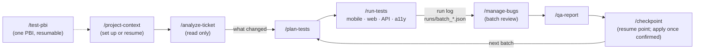

# QA Assistant — AI-Assisted Quality Engineering Framework

[](https://github.com/palmeida98/qa-assistant/actions/workflows/ci.yml)

**Active development · Python 3.12+ · Claude Code · Playwright · QA automation**

QA Assistant is a personal framework for planning, executing and reviewing quality-assurance work. It combines
**eight Claude Code skills** that drive a versioned QA method over project workspaces, a standalone **website audit
engine (`qa-audit`)** and a **local QA interface (`qa-ui`)**. The aim is repeatable test execution with traceable
evidence and explicit human approval before anything is written to a workbook or a tracker.

Source code, tests, a fictional demo, CI and technical documentation are included. Real client workspaces,
credentials, reports and evidence are kept outside this public repository, in private workspaces of their own.

> **Development status (November 2026):** an actively evolving project, **not a finished commercial product**. The
> workspace layer reached v1.0 after a controlled pilot and its skills are at version 2 (eight skills, methodology
> v2.13); `qa-audit` has its own v0.2.0 release; the single-workspace UI is implemented and the multi-project hub is
> being delivered in phases. See [state](#state) and the [development plan](docs/development-plan.md).

> **License:** publicly viewable **proprietary source**, not an open-source project. See [LICENSE](LICENSE) before
> copying, adapting or redistributing any part of it. Third-party components keep their own licences.

## At a glance

| Component | What it offers | Current evidence / boundary |
| --- | --- | --- |
| **Skills and workspaces** | Eight Claude Code skills for context, ticket analysis, planning, execution, bugs, reports and checkpoints over a workspace per project | Versioned methodology, a documented public-site pilot and an iOS device pilot; client data stays in separate workspaces |
| **`qa-audit` CLI** | Browser-based accessibility, passive security, functional, performance and opt-in visual checks | Python implementation, example configuration and browser integration tests in CI; not a penetration test or an accessibility certification |
| **`qa-ui`** | Local intake, test suggestions, batch execution, approval flows and results | Single-workspace mode implemented; the hub has discovery, pinning, in-hub navigation, Overview, write-only credentials and notes; other screens are planned |
| **Trackers** | Excel, Jira (Xray) and Azure DevOps (Test Plans + Boards) adapters | Excel used on real projects; Jira and Azure DevOps validated only against fakes and fictional goldens |
| **Mobile / remote execution** | Android (Maestro, emulator, companion driver), iPhone through WebDriverAgent, GitHub Actions workspace templates | Implemented tooling and tests; a full runner-based mobile pilot remains pending |

## Requirements

| For | Tool |
|---|---|
| Everything | git, Python 3.12+, Claude Code; GitHub CLI (`gh`) for a workspace's private remote |
| Tracker `excel` | LibreOffice (workbook recalculation and the golden test) |
| `functional-web`, `exploratory` | Node.js 22+ (Playwright MCP with a fixed version) |
| `accessibility`, `qa-audit` | Playwright browsers (`python -m playwright install chromium`) |
| `mobile` | Maestro CLI; Android SDK (adb, emulator) for Android; Xcode and WebDriverAgent for an iPhone ([technique-mobile.md §1.5](docs/technique-mobile.md)) |

Install only what the active modules of your projects need: `python scripts/validate_project.py <workspace>
--environment` says what is still missing on this computer. Step by step: [docs/workspace/setup.md](docs/workspace/setup.md).

## Installation and skill sync

```bash
git clone https://github.com/palmeida98/qa-assistant.git
cd qa-assistant
pip install -r requirements.txt              # the Excel adapter and the scripts (exact versions)
pip install -e .                             # qa-audit; or ./scripts/install.sh (a .venv and Chromium)
python scripts/sync_skills.py --apply        # copies the eight skills to ~/.claude/skills/ and records this checkout
python scripts/workspace_select.py where     # which framework, Python, imports and skill copy really run
```

The workspaces live outside this repository, so Claude Code uses the **global copy** of the skills in
`~/.claude/skills/`. Run `python scripts/sync_skills.py` (a dry run) to compare, and `--apply` after changing a skill,
preferably from the main checkout; the record next to the copies says which checkout and commit they came from. A
new Claude Code session is needed to see changed skills.

## The eight skills

Ask in natural language or type the skill's name. Each skill first finds the framework and selects the project
(preflight), and stops with an instruction when they do not match.

| Skill | Purpose |
|---|---|
| `/project-context` | Select or set up a workspace and resume it: state, decisions, blockers, tools really available, next actions |
| `/analyze-ticket` | Read a PBI, story, task or bug in Azure DevOps or Jira (read only), say what changed since the last check, give a QA analysis |
| `/plan-tests` | Plan by risk: coverage per requirement and platform, reuse of existing cases, new case proposals, batches |
| `/run-tests` | Run approved cases or a planned batch on mobile, web, API or accessibility, and record results and evidence in the run log |
| `/manage-bugs` | Investigate failures, search existing bugs, prepare proposals or updates for one batch review |
| `/qa-report` | Audit the run logs and report reconciled totals by platform, build, feature, result and risk; the Excel dashboard |
| `/checkpoint` | Save the session's state and resume point; apply a batch to the workbook or tracker only after confirmation |
| `/test-pbi` | Test one PBI end to end through the skills above, with a resume record (`memory/pbi/<id>.json`) |

Contracts (inputs, writes, approvals, failures) are in each skill's frontmatter: `python scripts/workspace_select.py
skills` prints the catalogue. Specification: [docs/skills-spec.md](docs/skills-spec.md); how to use them:
[docs/skills-guide.md](docs/skills-guide.md); the long procedures and the rules they share:
[docs/procedures/](docs/procedures/) ([rules.md](docs/procedures/rules.md)).

### What a request authorises



- A **request to test** covers the work inside its scope (platforms, environment and targets it names): analysis, a
  plan by risk, the run and the local records (run log, evidence, checkpoint), without approving the same plan twice.
- **Every write to a workbook or a tracker** (cases, results, bugs, comments, attachments) shows its exact content
  (a dry run) and waits for its approval. Another platform, environment or target is asked; a commit, a push or a
  sync of the skills is never a side effect.
- **A project's own rules win when they ask for more** (for example a confirmation of the plan or an approval of each
  platform's run); `/project-context` names the rules in force ([rules.md §5 and §8](docs/procedures/rules.md)).
- Generated cases are proposals until approved; one bug per problem, with platforms grouped only when the evidence
  shows the same defect; a result is written only for a case of the library, and its build, time and evidence are
  kept when a bug or evidence is attached later (`scripts/run_log.py attach`).

## Using it

### Choosing a project

Workspaces live under a root of workspaces (by default `../qa-workspaces/` next to the main checkout), as
`<company>/<project>/` or `<project>/`.

```bash
python scripts/workspace_select.py list                                    # each project: valid, incomplete, not-configured or inaccessible
python scripts/workspace_select.py preflight --skill plan-tests demo/shop  # project, task, environment and tools; nothing is written
python scripts/workspace_select.py set-root <folder>                       # another root of workspaces
```

Listing reads only each `project.yaml`; two projects never share memory or credentials. Details:
[docs/technique-workspaces.md](docs/technique-workspaces.md).

### Starting a new project

1. Create the folder `qa-workspaces/<company>/<project>/` (or `<project>/` under your root).
2. Open `claude` in that folder and run `/project-context` ([docs/procedures/onboarding.md](docs/procedures/onboarding.md)):
   it creates `CLAUDE.md`, `project.yaml`, `context.md` and `.claude/settings.json` (protection of `history/`), asks
   about environments, roles, tracker and modules, inspects the workbook or checks the tracker, and ends with
   `python scripts/validate_project.py <workspace>` without problems.
3. Fill in `.env` locally (variable names only in `.env.example`). The workspace is a git repository of its own with a
   **private** remote (`scripts/workspace_git.py`; `push` never forces and refuses a public remote).

### Modules

| Module | Technique | Skill | Tool |
|---|---|---|---|
| `functional-web`, `exploratory` | [browser](docs/technique-browser.md) | `/run-tests` | Playwright MCP |
| `api` | [API](docs/technique-api.md) | `/run-tests` | `scripts/api_request.py` |
| `accessibility` | [WCAG 2.1 AA](docs/technique-accessibility.md) | `/run-tests` | `scripts/audit_a11y.py` (`qa-audit` engine) |
| `mobile` | [mobile](docs/technique-mobile.md) | `/run-tests` | `scripts/run_mobile.py`, `scripts/device.py` (Maestro, Android driver, iOS WebDriverAgent) |

### Trackers

- **Excel** ([technique-excel.md](docs/technique-excel.md)): results and bugs applied at `/checkpoint` with
  `python -m adapters.excel.apply` (`--dry-run` first, then `--expect <token>`); approved cases added with
  `python -m adapters.excel.add_cases`; a dashboard with `scripts/build_dashboard.py`.
- **Jira (Xray) and Azure DevOps** ([technique-jira-xray.md](docs/technique-jira-xray.md),
  [technique-azure-devops.md](docs/technique-azure-devops.md)): `python -m adapters.tracker <workspace>
  check|import-cases|export-cases|apply|bug-search`; every writing command is a dry run without `--yes`, a batch is
  never sent twice.

### Following tickets

`/analyze-ticket` (`python -m adapters.tickets`) reads Azure DevOps or Jira through a transport that cannot write,
compares with the last check and writes only to the workspace's `memory/` and one generated block of `context.md`.
It needs neither Xray nor a `tracker:` of that kind. Specified in [docs/technique-tickets.md](docs/technique-tickets.md),
which says what was validated on a real service and what only with fictional fixtures.

### The local interface (`qa-ui`)

```bash
python -m qa_ui ../qa-workspaces/<company>/<project>   # one workspace: intake, suggestions, batches, runs, approvals
python -m qa_ui                                        # the hub: every project under the root
```

Local only: it binds to `127.0.0.1` with a per-start token and does not commit project history. Runs started from it
are unattended: new bugs are written as proposals and approved in the interface before anything is applied.
Specification: [docs/qa-ui.md](docs/qa-ui.md).

### `qa-audit` — automated website audit

```bash
./scripts/install.sh                     # Windows: .\scripts\install.ps1 (.venv, package, Chromium, qa-audit doctor)
qa-audit doctor
qa-audit https://example.com --type accessibility --browser firefox --max-pages 5
```

A first pass over a website from its URL: **accessibility** (axe-core 4.13.0 bundled, keyboard walk, reflow),
passive **security** (HTTPS/TLS, headers, cookies, mixed content), **performance** (TTFB, FCP, LCP, CLS),
**functional** (broken links and resources, JavaScript errors, redirects, forms submitted only with `--allow-submit`)
and opt-in **visual** (`pip install -e .[visual]`). It crawls with GET navigation only, respects `robots.txt`, can log
in first, and writes `qa-output/<timestamp>/` with `report.html`, `results.json` and screenshots. No telemetry. Only
audit sites you own or are authorised to test. Guide: [docs/qa-audit-guide.md](docs/qa-audit-guide.md); specification:
[docs/qa-audit.md](docs/qa-audit.md); example: [examples/qa-audit/](examples/qa-audit/).

## Layered architecture

| Layer | What it is | Where it lives |
|---|---|---|
| **Engine** | Skills, adapters, scripts, tests and guards; `qa-audit` next to it | `.claude/skills/`, `adapters/`, `scripts/`, `src/qa_audit/` |
| **1. Methodology** | The method: analysis, case design, batches, decision rules (Pass/Fail/N/A/Blocked/Question), bugs, checkpoints | [docs/methodology.md](docs/methodology.md), [docs/heuristics.md](docs/heuristics.md) |
| **2. Techniques** | How to test each type of test and use each tool | `docs/technique-*.md` |
| **3. Adapters** | Excel, Jira (Xray), Azure DevOps, tickets | `adapters/` |
| **4. Workspace** | The project: `CLAUDE.md`, `project.yaml`, `context.md`, workbook, `.env`, run logs, evidence | `qa-workspaces/<company>/<project>/` (outside this repository) |

The hierarchy of sources of truth, the generalisation rule and the process for changing the framework (specification
first, then code, then tests) are in the methodology (§1.3, §1.4, §15).

## Privacy boundary

Nothing that identifies a client enters this repository: names, environment URLs, accounts, credentials, workbooks,
results or bugs of real projects. Two barriers in `pre-commit`, never worked around:

- **detect-secrets**, with a baseline;
- a **personal denylist** (`~/.qa-denylist.txt`, outside the repository) of client names in the text, in file names,
  **inside** Office files and in the commit message.

Credentials live only in each workspace's `.env` and are referred to by the variable's name; the scripts pass them
through environment variables and redact the evidence. In a workspace, `.claude/settings.json` forbids Claude Code
from editing `history/`, which is immutable.

## Demo

[examples/demo/](examples/demo) is a complete fictional workspace against public practice sites
([saucedemo.com](https://www.saucedemo.com) and the [restful-booker](https://restful-booker.herokuapp.com) API): 38
cases in 6 areas, batches in `runs/`, example bugs, Maestro flows and Playwright regression specs (`e2e/`). The
workbook is rebuilt from the builder and the batches (`python examples/demo/rebuild_workbook.py`);
`python scripts/build_dashboard.py examples/demo --open` shows the dashboard.

## Validation

| Command | What |
|---|---|
| `python -m unittest discover -s tests` | Unit tests of the framework and the engine (those needing LibreOffice are skipped without it) |
| `python scripts/golden_check.py` | Golden test of the Excel adapter (needs LibreOffice); `--dir <workspace>/golden/<batch>` runs a project's real golden, whose data stays in the workspace |
| `python -m unittest discover -s tests/integration` | `qa-audit` against the local fixture site in real browsers (`QA_AUDIT_TEST_ENGINES`, default `chromium,firefox`) |
| `ruff check .` | Lint (ruff 0.16.8, `pip install -e .[dev]`) |
| `pre-commit run --all-files` | detect-secrets, ruff, the denylist, the golden and the unit tests, as on each commit |
| `python scripts/validate_project.py <workspace>` | A workspace's `project.yaml`, workbook and git settings; `--environment` adds the tools of this computer |
| `python scripts/qa_report.py <workspace> totals\|audit` | Reconciled totals per platform and build, and the audit of run logs, evidence and application (read only) |

The CI (GitHub Actions, Ubuntu 24.04) runs `lint`, `tests`, `secrets`, `golden` (with LibreOffice), `qa-audit`
(one job per engine in parallel: Chromium, Firefox, WebKit; one `qa-audit` status gathers them), `install` (clean clone
and audit of the local site) and `demo-e2e` on each pull request and on `main`. `demo-e2e` needs the repository's
`DEMO_SAUCE_*` secrets; without them it runs no spec and says so in a warning and in the run's summary. Python dependencies, ruff, detect-secrets and the Playwright MCP have exact versions; a test prevents
loose ones.

## State

| Phase | State |
|---|---|
| 0–7 · Base, Excel adapter, golden, browser, API/accessibility/mobile modules, CI, dashboard, closing | Done: **v1.0** (25.09.2026) |
| 8 · `qa-audit` engine and translation to English | 0.2.0: login, saved sessions, sitemap, several browsers |
| 9 · Conversational apps on a device, portable workspaces | Done |
| 10 · Jira (Xray) and Azure DevOps adapters | Implemented, validated only against fakes and fictional goldens; a pilot on real services is pending |
| 11 · Remote execution on GitHub Actions | The runner's side tested on a real workspace; the end-to-end with a real login is pending |
| 12 · `qa-ui` single-workspace interface | Implemented and tested with fixtures; a mobile-workspace pilot recorded; a web-site pilot is pending |
| 13 · `qa-ui` hub | Discovery, Projects, in-hub navigation, Overview, write-only credentials and notes done; project creation, Library, History, Inbox and Settings planned |
| 14 · `/analyze-ticket` | Azure DevOps through a browser: real read pilot done; Azure DevOps by token and Jira tested with fictional fixtures only |
| 15 · Central skills and project workspaces | Finding the framework, selecting a project, the skills' contract: implemented and tested with fixtures |
| Skills v2 (06–08.11.2026) | Eight skills with shared procedures; a request to test authorises its scope; `run_log.py attach`; iOS pilot improvements ([pilot-improvements-2026-11-07.md](docs/pilot-improvements-2026-11-07.md)) |

A completed phase is not a claim that every adapter was piloted against a live external tracker or that every hub
screen exists. History of changes: [CHANGELOG.md](CHANGELOG.md).

## Documentation

Start with the [documentation index](docs/README.md). The main references: [methodology](docs/methodology.md),
[skills guide](docs/skills-guide.md) and [specification](docs/skills-spec.md), [shared rules](docs/procedures/rules.md),
[workspaces and skills](docs/technique-workspaces.md), [setup](docs/workspace/setup.md) and
[resume on another computer](docs/workspace/resume.md), [contributing](CONTRIBUTING.md) and the
[development plan](docs/development-plan.md).
