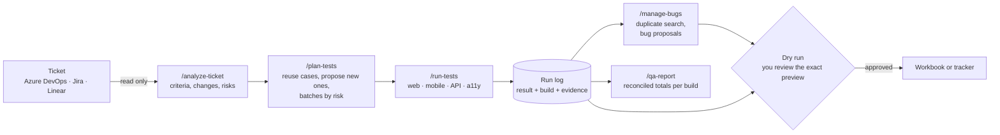

# QA Assistant

[](https://github.com/palmeida98/qa-assistant/actions/workflows/ci.yml)

Eight [Claude Code](https://claude.com/claude-code) skills and the tested scripts behind them, for a QA engineer who works
from tickets: analyse a ticket, plan by risk, run the approved cases, review the failures, report, and save the session.
Every result is traceable to a case, a build and its evidence, and **nothing is written to a workbook or a tracker until a
person approves the exact preview**.

> **Status:** proof of concept (November 2026), used by its author on real projects. **License:** proprietary, publicly
> viewable but not open source ([LICENSE](LICENSE)). Real projects, credentials, evidence and results live in private
> workspaces, never in this repository.

## Why it exists

An AI agent can click through an app and say "it works". For QA that is not enough: a result has to point to an approved
case, the build it ran on and the evidence that shows it; a failure has to be checked against existing bugs before a new
one is opened; and the team's workbook or tracker must never be changed by a guess. I built QA Assistant to keep those
rules while the agent does the repetitive work:

- **Traceability.** Every result is recorded against a case of the project's library, with its build, environment,
  execution time and evidence. An unknown case ID is refused; a result without a build is never counted as the current
  build.
- **Honest statuses.** Pass, Fail, N/A, Blocked and Not run follow written decision rules; a doubt is a `Question` that
  must be answered before any report, and a missing tool makes a case Blocked, never skipped or passed.
- **Human approval at every write.** The agent prepares; a person approves the exact preview of every cell, result and
  bug before it reaches Excel, Jira (Xray) or Azure DevOps.
- **Privacy by design.** The framework holds only method and code. Each client project lives in its own private
  workspace, and commit hooks block secrets and client names.

## How it works



1. **Analyse.** A ticket is read without writing to the tracker; the second read says what changed since the last one.
2. **Plan.** Existing cases are reused first; new ones are proposals until approved; batches are ordered to reuse logins
   and state without losing coverage.
3. **Run.** The agent drives the browser, a mobile device, an API or an accessibility audit and writes each result to a
   run log (JSON) in the workspace, with its evidence.
4. **Approve.** Failures become bug proposals. A dry run lists every change it would make, with a token; only that
   reviewed token (Excel) or `--yes` after the dry run (Jira, Azure DevOps) writes, and a stale preview is refused.
5. **Report.** Totals are reconciled per platform and build from the run logs, not from memory.

**Built with:** Python 3.12, Claude Code skills (Markdown contracts), openpyxl, Playwright, axe-core, Maestro (mobile),
the Jira/Xray and Azure DevOps REST APIs, GitHub Actions.

## Quick start

You need `git` and Python 3.12 or later. Nothing below touches a real system: it works on a temporary copy of the fictional
demo workspace ([`examples/demo`](examples/demo), a shop on public practice sites).

```bash
git clone https://github.com/palmeida98/qa-assistant.git && cd qa-assistant
python3 -m venv .venv && . .venv/bin/activate
pip install -r requirements.txt

WORK="$(mktemp -d)/demo" && cp -R examples/demo "$WORK"
python scripts/workspace_select.py preflight --skill run-tests --workspace "$WORK"
```

The preflight prints `Project: demo-saucedemo [demo] (valid)` and one `Route:` per kind of test. A route whose tool is
missing (here, the accessibility engine) is reported, and its cases would be Blocked, never skipped.

## Example: from a ticket to an approved write

The skills drive these scripts in a Claude Code session; here you run them by hand, in the same `$WORK`.

```bash
# 1. Analyse the ticket: two reads of the same fictional PBI; the second reports what changed
python -m adapters.tickets "$WORK" ingest "$WORK/tickets/bundle_check1.json" --now 2026-11-02T10:00:00
python -m adapters.tickets "$WORK" ingest "$WORK/tickets/bundle_check2.json" --now 2026-11-05T16:00:00

# 2. Plan: a batch of library cases, recorded before any result
mkdir -p "$WORK/batches"
printf 'module: functional-web\nrun:\n  environment: test\ncases: [TC-CHK-002, TC-LOGIN-004]\n' \
  > "$WORK/batches/batch_poc01.yaml"
python scripts/run_log.py "$WORK" plan poc01 batches/batch_poc01.yaml

# 3. Run: one pass, and one failure with a bug that stays a proposal until you approve it
python scripts/run_log.py "$WORK" add poc01 TC-CHK-002 Pass "Remove took the product out; the cart badge went to 0" \
  --environment test --build 1.4.0 --mode "manual: fictional example"
cat > "$WORK/bug.json" <<'JSON'
{"title": "Login without password shows no error", "area": "Login", "priority": "Medium", "severity": "Low",
 "role": "standard_user", "related_tc": "TC-LOGIN-004", "proposed": true,
 "description": "Expected: an error says the password is required. Observed: no message."}
JSON
python scripts/run_log.py "$WORK" add poc01 TC-LOGIN-004 Fail "No message without a password" --new-defect "$WORK/bug.json"

# 4. Prepare the write: a dry run. It refuses the proposed bug (exit 4) and writes nothing
python -m adapters.excel.apply "$WORK" runs/batch_poc01.json --dry-run --no-recalc

# 5. You approve the bug (drop "proposed"), record it again, and review the new dry run
python -c 'import json,sys; p=sys.argv[1]; d=json.load(open(p)); d.pop("proposed"); json.dump(d, open(p, "w"))' "$WORK/bug.json"
python scripts/run_log.py "$WORK" add poc01 TC-LOGIN-004 Fail "No message without a password" \
  --new-defect "$WORK/bug.json" --replace
python -m adapters.excel.apply "$WORK" runs/batch_poc01.json --dry-run --no-recalc
python scripts/qa_report.py "$WORK" totals
```

The last dry run lists every cell it would change (in `runs/batch_poc01.dryrun.md`) and prints a preview token `v2-…`. The
workbook stays byte for byte the same. Only `--expect <token>` writes, and it is refused if the batch, the workbook or
`project.yaml` changed since the preview. A longer walkthrough, run as a test, is in
[docs/demo-walkthrough.md](docs/demo-walkthrough.md).

## The QA flow

Install the skills into Claude Code, then open a session in a project workspace and ask in plain language or by name:

```bash
python scripts/sync_skills.py              # preview: each skill is same / different / missing; writes nothing
python scripts/sync_skills.py --apply      # copies the skills to ~/.claude/skills/ and records this checkout as their source
python scripts/workspace_select.py where   # which framework, Python and skill copy a session will use
```

| Skill | What it does | Writes |
|---|---|---|
| [`/project-context`](.claude/skills/project-context/SKILL.md) | Set up or resume a workspace: state, decisions, blockers, next actions | `CLAUDE.md`, `project.yaml`, `context.md` |
| [`/analyze-ticket`](.claude/skills/analyze-ticket/SKILL.md) | Read a ticket in Azure DevOps, Jira or Linear and say what changed | `memory/`, never the tracker |
| [`/plan-tests`](.claude/skills/plan-tests/SKILL.md) | Coverage by requirement and platform, reuse of cases, batches | `analysis/`, `batches/` |
| [`/run-tests`](.claude/skills/run-tests/SKILL.md) | Run approved cases (mobile, web, API, accessibility) with evidence | `runs/`, `evidence/` |
| [`/playwright-tests`](.claude/skills/playwright-tests/SKILL.md) | Write and run Playwright specs (level N2) for web cases and record their results | `e2e/`, `runs/`, `evidence/` |
| [`/maestro-tests`](.claude/skills/maestro-tests/SKILL.md) | Write and run Maestro flows (level N2) for mobile cases and record their results | `flows/`, `runs/`, `evidence/` |
| [`/manage-bugs`](.claude/skills/manage-bugs/SKILL.md) | Investigate failures, search duplicates, propose bugs for one review | proposals in the run log |
| [`/qa-report`](.claude/skills/qa-report/SKILL.md) | Audit the run logs; reconciled totals per platform and build | a report on request |
| [`/checkpoint`](.claude/skills/checkpoint/SKILL.md) | Save the session; apply a batch only after you confirm it | `context.md` |

Each skill starts with a preflight that checks its contract against the code and the tools present. A project can add its
own skills in its workspace; they are documented there.

## What you approve

- **Every write.** Workbook and tracker adapters do a dry run by default. The Excel apply needs the reviewed preview token;
  Jira and Azure DevOps need `--yes` after their dry run. A stale preview is refused.
- **Every new bug.** It is recorded as `proposed` and every adapter refuses it until you approve it.
- **Commits, pushes and skill syncs.** No skill does them as a side effect.
- **A project's stricter rules win** over these defaults (`CLAUDE.md` and what it imports).

## What is verified

- **Excel:** used on real projects. **Azure DevOps** guarded comments, attachments and bug creation: used on one real
  project. **Jira + Xray** and the other Azure DevOps writes: tested with fakes only. **Linear:** read only. Details:
  [docs/tracker-validation.md](docs/tracker-validation.md).
- **CI:** lint, secret scan, the Excel golden and the whole unit suite on Linux with LibreOffice, a clean install on `main`,
  and the audit engine on Chromium when it changes. macOS is checked locally; Windows is not. Details: [docs/ci.md](docs/ci.md).
- **Not evaluated:** whether an agent follows a skill in a real session ([docs/skills-evals.md](docs/skills-evals.md):
  scenarios prepared, not run).

The repository also contains `qa-audit`, a standalone website audit engine (accessibility, keyboard, passive security,
performance): [guide](docs/qa-audit-guide.md).

## Documentation

[Index](docs/README.md) · [skills guide](docs/skills-guide.md) · [methodology](docs/methodology.md) ·
[shared rules](docs/procedures/rules.md) · [workspace setup](docs/workspace/setup.md) · [changelog](CHANGELOG.md) ·
[contributing](CONTRIBUTING.md)
