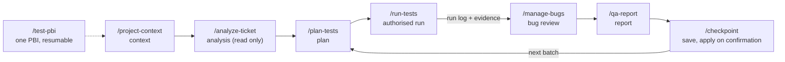

# QA Assistant

[](https://github.com/palmeida98/qa-assistant/actions/workflows/ci.yml)

Eight [Claude Code](https://claude.com/claude-code) skills that follow one written QA method over a project workspace, so that
analysis, test planning, execution, bug review and reporting are **traceable, resumable and approved by a person before anything
is written to a workbook or a tracker**. The method lives in versioned documents, the mechanical parts in tested scripts and
adapters, the judgement in the skills, and the decisions with you.

> **Status: proof of concept (November 2026).** An evolving personal project, not a finished product and not an agent that
> replaces QA judgement. Every claim says how far it was verified: implemented, tested with fictional fixtures, or used on a real
> project ([trackers](#trackers-what-is-verified), [CI](#ci)).
>
> **License: proprietary.** The source is publicly viewable but it is not open source: read [LICENSE](LICENSE) before copying or
> reusing any part of it. Real projects, credentials, evidence and results live in private workspaces, never in this repository.

## What it gives a QA engineer

- **Eight skills, one flow.** You open Claude Code in a project workspace and ask in natural language (or type a skill name).
  Each skill starts with a *preflight* that checks its contract against the code and the tools really present, and stops with an
  instruction when something does not match.
- **Traceability.** A result exists only for a case of the project's library and keeps its time, build and evidence. It is never
  edited over: a mistaken one is removed, a later execution is a new result. A result with no build is never counted as any build.
- **Resumable.** State, decisions, blockers and the next action are saved in the workspace (`context.md`, run logs, `memory/`),
  so another session continues where the last one stopped.
- **You approve the writes.** Every adapter does a **dry run** by default; a write needs the reviewed preview token or an explicit
  confirmation, and a stale preview is refused. A new bug is only a *proposal* until you approve it (one bug per problem).

## Quick start

Try the engine on a fictional demo (a shop on public practice sites): offline, nothing real is touched, and no Claude Code
session is needed for this part.

**You need:** `git` and Python 3.12+ (checked with 3.12 in CI and 3.13 locally on macOS). Nothing else for the commands below.

```bash
git clone https://github.com/palmeida98/qa-assistant.git
cd qa-assistant
python3 -m venv .venv && . .venv/bin/activate
pip install -r requirements.txt

WORK="$(mktemp -d)/demo" && cp -R examples/demo "$WORK"        # work on a temporary copy
python scripts/workspace_select.py preflight --skill run-tests --workspace "$WORK"
python -m adapters.tickets "$WORK" ingest "$WORK/tickets/bundle_check1.json" --now 2026-11-02T10:00:00
python -m adapters.tickets "$WORK" ingest "$WORK/tickets/bundle_check2.json" --now 2026-11-05T16:00:00
python scripts/qa_report.py "$WORK" totals
python -m adapters.excel.apply "$WORK" runs/batch_20260924_ui01.json --dry-run --no-recalc
```

**What you should see:**

| Command | First result |
|---|---|
| `preflight` | `Project: demo-saucedemo [demo] (valid)` and one route per kind of test. The accessibility route is `missing: qa-audit, browser chromium` until you install them: such a case would be Blocked (environment), not skipped |
| `ingest` (first) | `Check 20261102-100000: outcome complete, conclusion first, 2 ticket(s), 0 change(s)` |
| `ingest` (second) | `Check 20261105-160000: … conclusion changes, 2 ticket(s), 4 change(s)`: the comparison with the last check |
| `totals` | `Cases with a current result: 26`, Pass 23, Fail 3, `Reconciled … yes` |
| `adapters.excel.apply` | `DRY RUN … nothing is written to the workbook`, the target workbook and a preview token (`v2-…`); the workbook is byte for byte unchanged |

The walkthrough that adds a pass and a failure with a proposed bug, and the dry run that lists the cells it would change, is in
[docs/demo-walkthrough.md](docs/demo-walkthrough.md); a test runs it as written. It shows the engine the skills call, not the
agent's choices ([docs/skills-evals.md](docs/skills-evals.md): scenarios prepared, not yet run).

### Install the skills in Claude Code

```bash
python scripts/sync_skills.py              # preview: lists each skill as same / different / missing, writes nothing
python scripts/sync_skills.py --apply      # copies the eight skills to ~/.claude/skills/
python scripts/workspace_select.py where   # which framework, Python and skill copy are in use
```

`--apply` **changes your Claude Code configuration**: it copies the eight skills into `~/.claude/skills/` (replacing a copy of the
same name that differs), removes skills this framework has retired, records this checkout as their source, and leaves skills of
other origins alone. The preview without `--apply` is supported, and `--target <folder>` installs into a folder of your choice
instead (the tests use it, and so did the check of this README). Open a new Claude Code session to load changed skills.
Install the rest (LibreOffice, Node.js, Maestro, tokens…) only as a project's modules need it:
`python scripts/validate_project.py <workspace> --environment` says what is missing; step by step in
[docs/workspace/setup.md](docs/workspace/setup.md).

## The eight skills

Each skill's contract (inputs, writes, approvals, failures) is in its `SKILL.md`; the long procedures and the rules they share
are in [docs/procedures/](docs/procedures/). How to use them: [docs/skills-guide.md](docs/skills-guide.md); specification:
[docs/skills-spec.md](docs/skills-spec.md).

| Skill | What it is for | Writes (in the workspace) |
|---|---|---|
| [`/project-context`](.claude/skills/project-context/SKILL.md) | Select or set up a workspace; resume it: state, decisions, blockers, tools, next actions | `CLAUDE.md`, `project.yaml`, `context.md` (at onboarding) |
| [`/analyze-ticket`](.claude/skills/analyze-ticket/SKILL.md) | Read a PBI, story, task or bug in Azure DevOps or Jira (**read only**); what changed since the last check | `memory/`; never the tracker |
| [`/plan-tests`](.claude/skills/plan-tests/SKILL.md) | Plan by risk: coverage per requirement and platform, reuse of cases, proposals, ordered batches | `analysis/`, `batches/`; new cases only after approval |
| [`/run-tests`](.claude/skills/run-tests/SKILL.md) | Run approved cases on mobile, web, API or accessibility; record each result with evidence | `runs/`, `evidence/` |
| [`/manage-bugs`](.claude/skills/manage-bugs/SKILL.md) | Investigate failures, look for existing bugs, prepare proposals for one batch review | proposals in the run log |
| [`/qa-report`](.claude/skills/qa-report/SKILL.md) | Audit the run logs; reconciled totals per platform, build and result | read only (a report file on request) |
| [`/checkpoint`](.claude/skills/checkpoint/SKILL.md) | Validate and save the session; what is applied versus still to apply | `context.md`; a batch is applied only after confirmation |
| [`/test-pbi`](.claude/skills/test-pbi/SKILL.md) | One PBI end to end through the skills above, resumable in another session | `memory/pbi/<id>.json` |



The framework (this repository: method, skills, engine) never contains client data; a workspace (a separate private
repository per project) never contains the method. Layers and sources of truth: [methodology §1](docs/methodology.md).

## What stays with the person

| Decision | Who | Where it is enforced |
|---|---|---|
| Whether to test, on which platform, environment and target | You ask; a request to test authorises the work **inside that scope** | [rules.md §5](docs/procedures/rules.md) |
| Writing a case, a result or a bug to a workbook or tracker | You approve the exact content after a **dry run** | adapters: dry run by default; apply needs the preview token or `--yes` |
| A new bug | You (a proposal until approved) | the run log marks it `proposed`; every adapter refuses it |
| Commit, push, sync of the skills | You | never a side effect of a skill |
| A project's stricter rules | The project (they win over the defaults) | `CLAUDE.md` and what it imports |

Safeguards, each with tests and none a substitute for your review: a **destructive-command guard**
([`scripts/guard_destructive.py`](docs/technique-destructive-guard.md), a hook you install yourself; a text heuristic with false
positives); **result identity** (the Excel apply refuses a result already applied from another batch; a correction needs an
explicit `revision_of`); **proof levels** (`run_log.py add --observed/--claimed/--inferred`); **review-file checks**
(`scripts/check_approval_files.py`, read only, run by you); **acceptance-criteria coverage** (`scripts/ac_coverage.py`). Time of
execution vs time of record, resolving a Question, and the Excel preview token: [docs/skills-guide.md](docs/skills-guide.md),
[methodology §7.1 and §9.2](docs/methodology.md).

## QA apply: manual and reviewable

Applying a finished run log to the tracker is a **GitHub Actions workflow of the project's workspace** (template
[`docs/workspace/ci/apply.yml`](docs/workspace/ci/apply.yml), installed by `python scripts/workspace_ci.py <workspace> install`
as `qa-apply.yml`). It cannot run by itself:

1. **Manual only.** The only trigger is `workflow_dispatch` (Actions > *QA apply* > Run workflow); a push, pull request or schedule
   starts nothing, and only the repository owner can start the dry run.
2. **Dry run by default.** It writes nothing, refuses a run log that still has a `proposed` bug or a `Question`, and puts the
   review in the job summary (for Excel the cells and a preview token `v2-…`).
3. **Approval tied to the reviewed batch.** `mode: apply` needs the typed approval `APPLY <batch>` and, for Excel, the token of the
   dry run you reviewed; the adapter refuses, writing nothing, if the batch, `project.yaml` or a workbook changed since. Jira and
   Azure DevOps have no preview token, so there the typed approval and the dry run of the same run are the guard.
4. **A review branch, never `main`.** The result is pushed to a new branch `qa-apply/<batch>-<run id>` with only the workbook(s) or
   `tracker/` (any other changed file stops the push). You open the pull request, review the diff and merge it yourself.

Validated with the fictional demo and a local fake remote (`tests/test_apply_template.py`). On GitHub it has been exercised for
the refusal of invalid input only; a dry run of a real batch is still to be done. Procedure:
[docs/workspace/ci/README.md](docs/workspace/ci/README.md#applying-a-run-log).

## Trackers: what is verified

"Fixtures" means a fake service and fictional golden files: they prove the code follows its specification, not that it works
against the real service. "Real" means used by the author on a real project, not a test pilot. Full table and what a pilot needs:
[docs/tracker-validation.md](docs/tracker-validation.md).

| Tracker and operation | Implemented | Fixtures | Real service |
|---|---|---|---|
| **Excel**: read cases, add approved cases, apply results and bugs (dry run + token), dashboard | yes | yes (unit tests, LibreOffice golden) | **yes**, on real projects |
| **Azure DevOps**: read tickets (`/analyze-ticket`) | yes | yes | through a logged-in browser: yes; by token: **no** |
| Azure DevOps: import/export cases, send results (one test run per batch), create/update bugs, duplicate search | yes | yes | **no**, pilot pending (needs a test organisation) |
| Azure DevOps, guarded MCP server ([`ado_write_guard.py`](docs/technique-ado-write-guard.md)): **one comment** or **one attachment** per call, on work items assigned to a verified identity, read before and after, confirmation per call | yes | yes (own unit tests) | **yes**, comments and attachments, on one real project |
| Azure DevOps guarded server: **bug creation** | implemented, **disabled by default** | yes | **no** |
| **Jira + Xray** (Cloud): the same four directions (one Test Execution per batch) and ticket reading | yes | yes | **no**, pilot pending (needs a test site with Xray) |

So the Azure DevOps result, case and bug writes and every Jira write are **implemented and tested with fakes only**. The guard is
a local safeguard, not a permission model: the tracker does not limit writes per assignee. No parity between trackers is
claimed (the dashboard is Excel only).

## CI

The badge at the top shows the **CI workflow** ([`ci.yml`](.github/workflows/ci.yml)) on `main` and nothing else: it says nothing
about the Windows suite or `demo-e2e`, which are separate workflows below.

CI runs on every pull request, on push to `main` and on demand (`workflow_dispatch`), with a read-only token, no persisted
credentials and actions pinned to a commit SHA:

| Job | What |
|---|---|
| `lint`, `secrets` | ruff; detect-secrets with a baseline |
| `tests` (Ubuntu), `tests-macos` | the whole unit suite |
| `windows-only-tests` | only the two tests that exist for Windows |
| `golden` | the Excel golden and the LibreOffice-dependent tests |
| `qa-audit` (Chromium, Firefox, WebKit) | the audit engine against a local fixture site, plus a cross-engine comparison |
| `install` | a clean clone: the audit of the fixture site, the eight skills synced to a temporary folder and their preflight on the demo |
| `ci-status` | one aggregate result: success only when every job above succeeded (or, for the browsers, was skipped by design) |

- **Pull request vs `main`.** On a pull request the three browser jobs (about 80% of the runner minutes) run only when it touches
  `src/`, the integration tests or the fixture site, the summary script they call, the dependency files or `.github/` (job
  `changes`; checked by `tests/test_ci_filter.py`); otherwise `qa-audit` reports "skipped by design" and `ci-status` still
  passes. `main` and manual runs always run everything. A pull request keeps one run (a newer push cancels the older); `main`
  runs are never cancelled.
- **`ci-status` is not enforced yet.** It is meant to be the single check to require, but on 11.11.2026 `main` has no branch
  protection and no ruleset (checked through the GitHub API), so nothing blocks a merge on it today.
- **What "green" means.** Each test job writes its counts and skips by reason to the run summary and fails if no test ran or a
  skip has a reason that is not allowed (`golden`: no skip at all). A skipped test proved nothing.
- **Windows is unconfirmed, and separate.** The **Windows suite** workflow
  ([`windows-suite.yml`](.github/workflows/windows-suite.yml)) runs the whole suite on Windows, is **red** while tests fail and is
  not part of `ci-status`. Its known failures are listed in [`.github/known-failures-windows.txt`](.github/known-failures-windows.txt)
  and reported apart from any new one.
- **`demo-e2e` is a separate workflow** ([`demo-e2e.yml`](.github/workflows/demo-e2e.yml)), not a CI check: Playwright specs against
  a public practice site, started by hand or weekly when the repository variable `DEMO_E2E_SCHEDULE` is `true`. It needs the
  three repository secrets (named in the header of the workflow file); without them it fails with a clear message. No end-to-end coverage is claimed until it has run with executed specs.

**Dated results** (commit `2307430`, 11.11.2026): CI [run 42957805137](https://github.com/palmeida98/qa-assistant/actions/runs/42957805137)
succeeded: Ubuntu 1842 tests run, 0 failed, 23 skipped; macOS 1842 run, 0 failed, 24 skipped; `golden` 44 run, 0 skipped;
`windows-only-tests` 2 run. **Windows suite** [run 42957805113](https://github.com/palmeida98/qa-assistant/actions/runs/42957805113)
failed, as expected: 1842 run, 13 failed or errored (all 13 on the known list, 0 new), 32 skipped. `demo-e2e` has not been
observed running. Numbers change with the code: each run's summary has its own counts. Local and CI environments differ in some
versions (for example Pillow and LibreOffice); `python scripts/workspace_select.py where` prints the difference.

Privacy guards on every commit: detect-secrets with a baseline and a private denylist kept outside the repository (a missing or
unreadable list is reported, never called clean). Hooks can be bypassed and CI runs after a push, so review stays necessary.

## Also in this repository: `qa-audit`

A standalone website audit engine (v0.2.0): axe-core accessibility, a keyboard walk, passive security checks, performance,
functional and opt-in visual checks in Chromium, Firefox or WebKit, with an HTML and JSON report. It is not a penetration test or an
accessibility certification, and only sites you are authorised to test should be audited. [Guide](docs/qa-audit-guide.md) ·
[specification](docs/qa-audit.md).

## Limitations and next steps

- **No interface of its own, by decision.** The product is the skills in Claude Code.
- **Trackers:** Azure DevOps and Jira + Xray writes still need a pilot on a test instance.
- **Agent behaviour is not formally evaluated.** The tests check contracts, scripts and documents; whether an agent follows a
  skill in a real session is covered by prepared scenarios that have not been run.
- **Platforms:** developed and used on macOS; CI runs the suite on Linux and macOS and the browsers on Linux. Windows is
  unconfirmed; Firefox and WebKit on macOS are not confirmed.
- **Mobile:** Android (Maestro, emulator, companion driver) and iPhone (WebDriverAgent) tooling exist; each device and build is
  verified in its own project, never assumed ([docs/technique-mobile.md](docs/technique-mobile.md)).
- A person reviews every proposal; no productivity or coverage figure is claimed.

## Documentation

[Index](docs/README.md) · [methodology](docs/methodology.md) · [skills guide](docs/skills-guide.md) ·
[skills specification](docs/skills-spec.md) · [shared rules](docs/procedures/rules.md) · techniques
([browser](docs/technique-browser.md), [API](docs/technique-api.md), [accessibility](docs/technique-accessibility.md),
[mobile](docs/technique-mobile.md), [Excel](docs/technique-excel.md), [Jira + Xray](docs/technique-jira-xray.md),
[Azure DevOps](docs/technique-azure-devops.md), [tickets](docs/technique-tickets.md),
[workspaces](docs/technique-workspaces.md)) · [roadmap](docs/development-plan.md) · [changelog](CHANGELOG.md) ·
[contributing](CONTRIBUTING.md).
