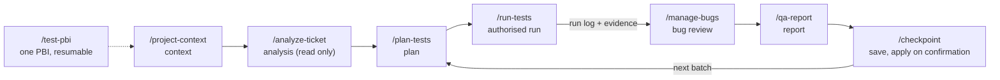
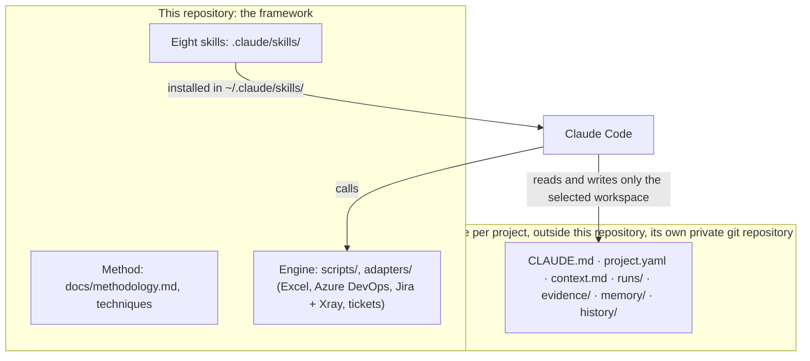

# QA Assistant

[](https://github.com/palmeida98/qa-assistant/actions/workflows/ci.yml)

A QA assistant for [Claude Code](https://claude.com/claude-code): eight skills that follow one written QA method over a
project workspace, so that analysis, test planning, execution, bug review and reporting are **traceable, resumable and
approved by a person before anything is written to a workbook or a tracker**.

> **Status: proof of concept (November 2026).** An actively evolving personal project, not a finished product and not an
> agent that replaces QA judgement. Each claim below says how far it was verified: implemented, tested with fictional
> fixtures, or used on a real project. The state of each tracker is in [one table](#trackers-what-is-verified) and in
> [docs/tracker-validation.md](docs/tracker-validation.md).
>
> **License:** publicly viewable proprietary source, not open source. Read [LICENSE](LICENSE) before copying or reusing
> any part of it. Real projects, credentials, evidence and results live in private workspaces, never in this repository.

## The problem and the purpose of the POC

QA work with an AI assistant fails in familiar ways: results that cannot be traced to a case or a build, a plan that is
forgotten between sessions, a "Pass" that nobody can verify, a bug filed twice, a workbook overwritten by a confident
agent. This project tries one answer: put the **method** in versioned documents, put the **mechanical parts** in tested
scripts and adapters, let Claude Code do the **judgement** through skills, and keep a **person** in front of every write.

The proof of concept asks one question: *can a QA engineer use Claude Code, with these skills and this method, to run a
real test cycle on a real project, with less repeated work and no loss of traceability?* This repository is the framework;
the first real application is a private mobile-app workspace.

## How it works

You open Claude Code in a project's workspace and ask in natural language (or type a skill's name). Each skill starts
with a **preflight**: it finds the framework, selects the project, checks the skill's contract against the code and the
tools really present, and stops with an instruction when something does not match.

| Skill | What it is for | What it writes (in the workspace) |
|---|---|---|
| `/project-context` | Select or set up a workspace; resume it: state, decisions, blockers, tools really available, next actions | `CLAUDE.md`, `project.yaml`, `context.md` (at onboarding) |
| `/analyze-ticket` | Read a PBI, story, task or bug in Azure DevOps or Jira (**read only**); say what changed since the last check | `memory/` and one generated block of `context.md`; never the tracker |
| `/plan-tests` | Plan by risk: coverage per requirement and platform, reuse of existing cases, proposals for new ones, ordered batches | `analysis/`, `batches/`; new cases only after approval |
| `/run-tests` | Run approved cases on mobile, web, API or accessibility and record each result with its evidence | `runs/` (run log), `evidence/` |
| `/manage-bugs` | Investigate failures, look for existing bugs, prepare proposals or updates for one batch review | bug proposals in the run log, approved ones recorded |
| `/qa-report` | Audit the run logs; reconciled totals per platform, build and result; a summary for the team | read only (a report file only on request; an Excel dashboard) |
| `/checkpoint` | Validate and save the session: results, a resume point, what is applied versus still to apply | `context.md`; a batch is applied only after confirmation |
| `/test-pbi` | Test one PBI end to end through the skills above, resumable in another session | `memory/pbi/<id>.json` plus what each step writes |

Each skill's contract (inputs, writes, approvals, failures) is in its frontmatter; `python scripts/workspace_select.py
skills` prints the catalogue. Specification: [docs/skills-spec.md](docs/skills-spec.md); how to use them:
[docs/skills-guide.md](docs/skills-guide.md); the long procedures and the rules they share:
[docs/procedures/](docs/procedures/).

### The flow



## What stays with the person

| Decision | Who | Where it is enforced |
|---|---|---|
| Whether to test, which platform, environment and target | The person asks; a request to test authorises the work **inside that scope** (analysis, plan, run, local records) without a second approval | [rules.md §5](docs/procedures/rules.md) |
| Writing a case, a result or a bug to a workbook or a tracker | The person approves the exact content, after a **dry run** | adapters: a dry run is the default; apply needs a preview token or `--yes`; a stale preview is refused |
| A new bug | The person (a bug is a *proposal* until approved; one bug per problem) | the run log marks it `proposed`; every adapter refuses it |
| Commit, push, sync of the skills | The person | never a side effect of a skill |
| A project's stricter rules | The project (they win over the defaults) | `CLAUDE.md` and what it imports; `/project-context` lists them |

Traceability: a result exists only for a case of the project's library, keeps its time, its build and its evidence, and
is never edited over (a mistaken one is removed, a later execution is a new result). Finished batches in `history/` are
immutable. Reconciled totals never add platforms into one percentage, and a result with no build recorded is never
counted as any build.

## Architecture



The framework never contains client data; a workspace never contains the method. Layers, privacy boundary and the order of
the sources of truth: [methodology §1](docs/methodology.md).

## Trackers: what is verified

| Tracker | Implemented | Verified with fixtures | Used on a real instance |
|---|---|---|---|
| **Excel** (workbook) | read cases, add approved cases, apply results and bugs with a dry run and a preview token, dashboard | yes: unit tests and a golden test (LibreOffice) | **yes**, on real projects |
| **Azure DevOps** (Test Plans + Boards) | import and export cases, send results (one test run per batch), create/update bugs, duplicate search | yes: fake service and fictional golden | **no: pilot pending** (needs a test organisation) |
| **Jira + Xray** (Cloud) | the same four directions (one Test Execution per batch) | yes: fake service and fictional golden | **no: pilot pending** (needs a test site with Xray) |
| Ticket reading (`/analyze-ticket`) | Azure DevOps and Jira, read only, compared with the last check | yes, and the demo below | Azure DevOps through a logged-in browser: yes; by token, and Jira: no |

Fixtures prove the code follows its specification; they do not prove it works against the real service. Until the pilots
exist, the Azure DevOps and Jira writes are **implemented and tested with fakes only**. No parity between trackers is
claimed (for example the dashboard is Excel only). Details and what a real pilot needs:
[docs/tracker-validation.md](docs/tracker-validation.md).

## Install

```bash
git clone https://github.com/palmeida98/qa-assistant.git
cd qa-assistant
python3 -m venv .venv && . .venv/bin/activate          # Python 3.12+
pip install -r requirements.txt                        # the Excel adapter and the scripts (exact versions)
pip install -e .                                       # the qa-audit engine (optional; see requirements below)
python scripts/sync_skills.py --apply                  # copies the eight skills to ~/.claude/skills/, records this checkout
python scripts/workspace_select.py where               # which framework, Python, imports, skill copy and commit guards run
```

`sync_skills.py` without `--apply` is a dry run, and `--target <folder>` installs somewhere else (used by the tests). Skills
of other origins are kept. A new Claude Code session is needed to load changed skills. Workspaces use the global copy, so
sync from the main checkout once the change is integrated.

| For | Needs |
|---|---|
| Everything | git, Python 3.12+, Claude Code; GitHub CLI (`gh`) for a workspace's private remote |
| Tracker `excel` | LibreOffice (recalculation, the golden test) |
| `functional-web`, `exploratory` | Node.js 22+ (Playwright MCP, a fixed version) |
| `accessibility`, `qa-audit` | `pip install -e .` and Playwright browsers (`python -m playwright install chromium`) |
| `mobile` | Maestro; Android SDK for Android; Xcode and WebDriverAgent for an iPhone ([technique-mobile.md](docs/technique-mobile.md)) |
| Azure DevOps / Jira | a token in the workspace's `.env` (names in `project.yaml`, values never in a repository) |

Install only what a project's modules need: `python scripts/validate_project.py <workspace> --environment` says what is
missing. Workspaces live under a root (by default `../qa-workspaces/` next to the main checkout); start one with
`/project-context`. Step by step: [docs/workspace/setup.md](docs/workspace/setup.md).

## Try it with fictional data (offline, nothing real is touched)

[`examples/demo`](examples/demo) is a fictional workspace (a demo shop on public practice sites). On a temporary copy:

```bash
WORK="$(mktemp -d)/demo" && cp -R examples/demo "$WORK"
python scripts/workspace_select.py preflight --skill run-tests --workspace "$WORK"          # project, tools, routes; read only
python -m adapters.tickets "$WORK" ingest "$WORK/tickets/bundle_check1.json" --now 2026-11-02T10:00:00
python -m adapters.tickets "$WORK" ingest "$WORK/tickets/bundle_check2.json" --now 2026-11-05T16:00:00   # "changes"
python scripts/qa_report.py "$WORK" totals                                                  # reconciled totals
```

The full path (a run log with a pass and a failure with a proposed bug, then the Excel dry run that lists the cells it would
change and writes nothing) is in [docs/demo-walkthrough.md](docs/demo-walkthrough.md), and a test runs it as written. This
shows the engine the skills call; it does not show the agent's choices ([docs/skills-evals.md](docs/skills-evals.md):
scenarios prepared, not yet run).

## Validation and CI

| Command | What |
|---|---|
| `python -m unittest discover -s tests` | Unit tests of the framework and the engine |
| `python scripts/golden_check.py` | Golden test of the Excel adapter (needs LibreOffice) |
| `python -m unittest discover -s tests/integration` | `qa-audit` against a local fixture site, in real browsers |
| `ruff check .` | Lint (ruff 0.16.8) |
| `pre-commit run --all-files` | detect-secrets, ruff, the private denylist, the golden and the unit tests |

**Measured on 08.11.2026**, macOS, Python 3.12, from the exact versions of `requirements.txt` and `pip install -e
.[dev,visual]`: **1453 unit tests, 0 failures, 3 skipped** (Windows- and Linux-only cases), and the Excel golden passes.
The browser integration tests ran in CI on Linux; they were not run locally for this POC. Numbers change with the code:
the CI writes the current counts and every skip with its reason in each run's summary.

GitHub Actions (Ubuntu 24.04) runs on each pull request and on `main`: `lint`, `tests`, `secrets`, `golden` (with
LibreOffice), `qa-audit` (Chromium, Firefox and WebKit in parallel, a cross-engine comparison, one aggregate status),
`install` (a clean clone: the audit of the local fixture site, then the eight skills synced to a temporary folder and
their preflight on the fictional demo) and `demo-e2e`.

**`demo-e2e` runs Playwright specs against a public practice site and needs the repository's `DEMO_SAUCE_*` secrets. Without
them the job is skipped, not green, and its summary says "NOT RUN": no end-to-end coverage is claimed until the secrets
exist and the summary reports executed specs.**

Privacy guards on every commit: detect-secrets with a baseline, and a private denylist of client names kept outside the
repository (it reads file names, text, the inside of Office files and the commit message; a missing or unreadable list or
file is reported, never called clean). Hooks can be bypassed and CI runs after a push, so review stays necessary.

## Also in this repository: `qa-audit`

A standalone website audit engine (`qa-audit`, v0.2.0): axe-core accessibility, a keyboard walk, passive security checks,
performance, functional and opt-in visual checks, in Chromium, Firefox or WebKit, with an HTML and JSON report. It is not a
penetration test or an accessibility certification, and only sites you are authorised to test should be audited.
[Guide](docs/qa-audit-guide.md) · [specification](docs/qa-audit.md).

## Limitations and next steps

- **No interface of its own, by decision.** The product is the skills in Claude Code. An earlier local web interface and a
  multi-project hub were retired from the scope; their code is legacy ([docs/qa-ui.md](docs/qa-ui.md)).
- **Trackers:** Azure DevOps and Jira + Xray writes still need a pilot on a test instance (next step for the proof of concept).
- **Agent behaviour is not formally evaluated.** The tests check the contracts, the scripts and the documents; whether an
  agent follows a skill in a real session is covered by prepared scenarios that have not been run.
- **Platforms:** developed and used on macOS; CI runs on Linux. Windows, Firefox and WebKit on macOS are not confirmed here.
- **Remote execution** (a workspace's CI on a runner) exists but is outside this version and not validated end to end.
- **Mobile:** Android (Maestro, emulator, companion driver) and iPhone (WebDriverAgent) tooling exist; each real device and
  build is verified in its own project, never assumed.
- A person reviews every proposal; no productivity or coverage figure is claimed.

## Documentation

[Index](docs/README.md) · [methodology](docs/methodology.md) · [skills guide](docs/skills-guide.md) ·
[skills specification](docs/skills-spec.md) · [shared rules](docs/procedures/rules.md) · techniques
([browser](docs/technique-browser.md), [API](docs/technique-api.md), [accessibility](docs/technique-accessibility.md),
[mobile](docs/technique-mobile.md), [Excel](docs/technique-excel.md), [Jira + Xray](docs/technique-jira-xray.md),
[Azure DevOps](docs/technique-azure-devops.md), [tickets](docs/technique-tickets.md),
[workspaces](docs/technique-workspaces.md)) · [roadmap](docs/development-plan.md) ·
[changelog](CHANGELOG.md) · [contributing](CONTRIBUTING.md).
